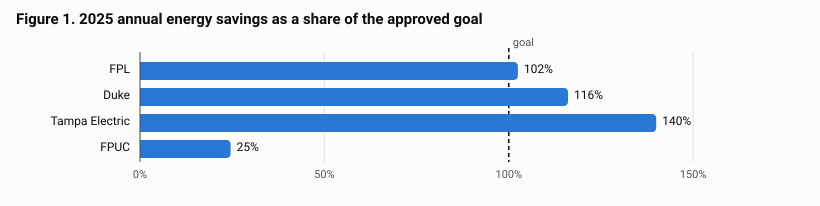
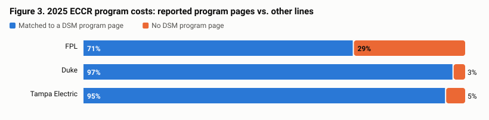
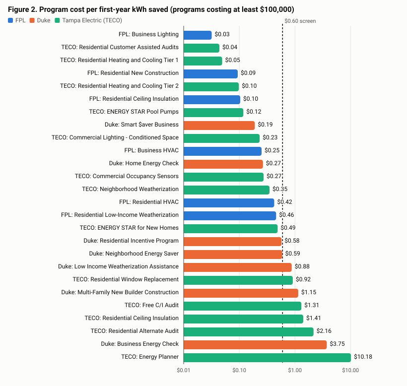

# Review of 2025 Conservation Program Results and Cost Recovery: Florida Investor-Owned Electric Utilities

| | |
|---|---|
| **Date** | November 7, 2026 |
| **Subject** | 2025 demand-side management (DSM) results and Energy Conservation Cost Recovery (ECCR) program costs for Florida Power & Light, Duke Energy Florida, Tampa Electric and Florida Public Utilities |
| **Format** | Written in the structure of a utility-commission staff recommendation (case background, issues, recommendation, analysis) |
| **Prepared with** | Claude, Anthropic's AI assistant, which retrieved the filings, wrote the analysis code and drafted this document under the author's direction (see Appendix C) |
| **Status** | **Independent analysis of public filings. This is not a Florida Public Service Commission document, does not represent Commission staff, and makes no regulatory finding.** |

---

## Summary of recommendations

| Issue | Question | Recommendation |
|---|---|---|
| 1 | Did each utility meet its 2025 approved numeric conservation goals? | FPL and Duke met all three 2025 goals (annual energy, summer and winter peak demand). Tampa Electric met its energy and summer goals but missed its winter demand goal. FPUC missed all three. |
| 2 | Do the program-level savings in each DSM report add up to the totals each utility reports? | Yes for FPL and Duke. No for Tampa Electric (a 2.2 GWh gap) and FPUC (summary tables appear to swap meter and generator energy totals). Ask both utilities to reconcile before relying on their totals. |
| 3 | Do the program costs in the DSM reports agree with the ECCR true-up filings? | Yes, closely: 55 of 57 program costs agree within the reports' rounding; the 2 exceptions total $192. FPUC was not cross-checked. |
| 4 | Are there ECCR costs that do not appear in any DSM program report? | Yes: $55.3 million (16% of the three utilities' combined ECCR program costs), mostly FPL's closed Commercial/Industrial Load Control program and administrative lines. Request support for each line. |
| 5 | Which energy-efficiency programs look cost-effective on a screening basis, and which need more support? | Of 26 programs costing at least $100,000, 8 appear cost-effective on both measures used, 11 give mixed signals and 6 need more support (see Table 6). |
| 6 | How sensitive are the cost results to participation? | Moderately. A 20% participation shortfall raises cost per kWh by about 7.5% under the assumed cost structure; 2 of 26 programs would change screening tier. |
| 7 | Do the filings meet the Commission's reporting requirements? | Mostly. FPL's filings meet all 20 requirements checked. Duke and Tampa Electric do not justify all goal variances above 15% and include no advertising savings-claim documentation; Duke's report shows a 2025 energy goal (56 GWh) that differs from its order (55 GWh); FPUC's report omits several program items and doesn't match its 2024 goals order. |
| 8 | What reporting improvements should be requested? | Consistent net-benefit methodology, measure lives, cost basis disclosure and reconciliation tables (see Issue 8). |

---

## Case background

**Legal framework.** The Florida Energy Efficiency and Conservation Act (FEECA) requires the Commission to set numeric conservation goals for the utilities it covers and to approve plans to meet them. Goals are set under Rule 25-17.0021, Florida Administrative Code, and utilities report results annually under subsection (5) of that rule. Utilities recover the cost of approved conservation programs through the Energy Conservation Cost Recovery clause under Rule 25-17.015, F.A.C., which includes an annual final true-up of actual against projected costs.

**Current goals.** The goals in effect for 2025 were set in 2024 for each utility: FPL, Order No. PSC-2024-0505-FOF-EG (Docket 20240012-EG); Duke Energy Florida, Order No. PSC-2024-0429-FOF-EG (Docket 20240013-EG); Tampa Electric, Order No. PSC-2024-0430-FOF-EG (Docket 20240014-EG); and FPUC, Order No. PSC-2024-0431-FOF-EG (Docket 20240015-EG). 2025 is the first year of the new goal period.

**Filings reviewed.**
- Each utility's 2025 DSM annual report, filed in February-March 2026 and posted on the Commission's website. These give program-level participation, demand and energy savings, cost and the utility's reported net benefits.
- The 2025 ECCR final true-up testimony and exhibits for FPL (Exhibit LSN-1), Duke (Exhibit KR-1T) and Tampa Electric (Exhibit RGJ-1), all filed May 5, 2026 in Docket 20260002-EG. These give actual 2025 conservation costs by program.
- FPUC's ECCR true-up was not located among the filings reviewed.

**Scope.** This review compares what the utilities reported against their goals, checks the filings for internal consistency and agreement with each other, and screens program cost per kWh saved. It does **not** audit the underlying records, re-run the Commission's cost-effectiveness tests, evaluate the true-up interest or revenue calculations, or recommend changes to recovery factors. Full methods and limits are in Appendix C.

---

## Discussion of issues

### Issue 1: Did each utility meet its 2025 approved numeric conservation goals?

**Recommendation:** FPL and Duke met all three 2025 goals. Tampa Electric missed its winter peak demand goal while exceeding its energy goal by a wide margin. FPUC fell short on all three, with energy savings at 25% of goal. FPUC's shortfall should be monitored in 2026; one transition year doesn't establish a pattern.

**Analysis:** Table 1 shows each utility's reported 2025 achievement against its approved goal, at the generator.

*Table 1. 2025 achieved vs. goal (achieved / goal, % of goal)*

| Utility | Annual energy (GWh) | Summer peak (MW) | Winter peak (MW) |
|---|---|---|---|
| Florida Power & Light | 102.57 / 100.08 (102%) | 54.81 / 46.06 (119%) | 38.76 / 31.44 (123%) |
| Duke Energy Florida | 65 / 55 (118%) | 51 / 28 (182%) | 61 / 35 (174%) |
| Tampa Electric | 65.8 / 47.0 (140%) | 16.1 / 14.3 (113%) | 16.8 / 19.4 (87%) |
| Florida Public Utilities | 0.127 / 0.517 (25%) | 0.012 / 0.077 (16%) | 0.074 / 0.176 (42%) |

- **FPL** exceeded all three goals; its energy savings were 2% above goal, and its demand savings 19-23% above.
- **Duke** reports figures rounded to whole MW and GWh, with variances of +18% (energy), +80% (summer) and +72% (winter) against its total goals. Most of the demand margin comes from commercial/industrial programs, where Duke reports variances of +597% (winter) and +300% (summer) against small goals of 4 and 7 MW. Duke's report shows a 2025 energy goal of 56 GWh, but its goals order sets 55 GWh (the 56 is the 2026 goal); this review uses the order's figure (Issue 7).
- **Tampa Electric** exceeded its energy goal by 40% and its summer goal, but reached 86.7% of its combined winter goal as reported (86.0% residential, 88.4% commercial/industrial). It moved to its new 2025-2034 program portfolio on June 1, 2025, after the plan was approved in April, and states that it would have met all 2025 goals had the new plan started January 1.
- **FPUC** describes 2025 as a transition year: residential programs were restructured and commercial programs had no participants. The goals are small in absolute terms (0.517 GWh), so a handful of additional participants moves the result substantially. FPUC's report also compares against goals that differ from its 2024 goals order; against the order's 0.465 GWh, FPUC reached about 28% of its energy goal (Issue 7).

Tampa Electric's and FPUC's achievement figures are affected by the reconciliation issues in Issue 2, but neither issue is large enough to change whether a goal was met.

### Issue 2: Do the program-level savings in each DSM report add up to the totals each utility reports?

**Recommendation:** FPL's and Duke's program savings reconcile to their reported totals. Tampa Electric's program pages fall 2.2 GWh (3.4%) short of its reported 65.8 GWh, and FPUC's summary tables appear to have their meter and generator energy totals swapped. Ask Tampa Electric to provide a reconciliation from program pages to its summary, and FPUC to confirm and correct its Tables 2-3 and 2-6.

**Analysis:** Each DSM report gives savings for every program and a summary total. If the report is internally consistent, the program figures should add up to the total.

*Table 2. Sum of program pages vs. reported total, GWh at the generator*

| Utility | Sum of program pages | Reported total | Difference | % |
|---|---|---|---|---|
| Florida Power & Light | 102.571 | 102.570 | +0.001 | +0.0% |
| Duke Energy Florida | 65.442 | 65.000 | +0.442 | +0.7% |
| Tampa Electric | 63.593 | 65.800 | -2.207 | -3.4% |
| Florida Public Utilities | 0.131 | 0.127 | +0.004 | +3.3% |

- **FPL** reconciles exactly. **Duke**'s small difference is within its rounding to whole GWh.
- **Tampa Electric** reports many programs under both its 2020-2029 and 2025-2034 DSM plans, and for several audit programs prints a combined row that it marks as not counted toward achievements. This review uses the 2025-2034 plan rows, because 2025 goals come from that plan. On that basis the program pages total 63.6 GWh. Using the combined rows instead gives about 91 GWh. Neither matches the reported 65.8 GWh, and the report does not show how the summary was built.
- **FPUC**: its program pages total 127,350 kWh at the meter and 131,160 kWh at the generator. FPUC's Table 2-3 (labelled "At the Generator") shows 0.127 GWh and Table 2-6 ("At the Meter") shows 0.131 GWh. Generator savings include line losses and should be the larger figure, so the energy labels appear swapped. The winter MW figures in the same tables are labelled correctly. The effect on FPUC's goal comparison is small (0.131 rather than 0.127 GWh achieved against 0.517).

### Issue 3: Do the program costs in the DSM reports agree with the ECCR true-up filings?

**Recommendation:** Yes. The DSM reports and the ECCR true-up schedules are consistent for FPL, Duke and Tampa Electric: 55 of 57 program-level comparisons agree within the DSM reports' rounding. The 2 exceptions (Tampa Electric Energy Planner, $130; Tampa Electric Residential Prime Time Plus, $62) are immaterial but could be explained in Tampa Electric's next report. FPUC's costs should be cross-checked once its ECCR true-up exhibit is obtained.

**Analysis:** First, each true-up exhibit's program lines were added up and compared with the filed total.

*Table 3. ECCR true-up program lines vs. filed totals (2025 actual)*

| Utility | Sum of program lines | Filed total | Difference | DSM-to-ECCR program matches |
|---|---|---|---|---|
| Florida Power & Light | $168,697,311 | $168,697,310 | $1 | 14 of 14 |
| Duke Energy Florida | $124,029,727 | $124,029,727 | $0 | 12 of 12 |
| Tampa Electric | $47,648,597 | $47,648,597 | $0 | 29 of 31 |

FPL's $1 difference is rounding in the filing. Tampa Electric's filed total here is before it removes its Renewable Energy (Sun to Go) program ($51,578), which is recovered separately; its "Total Program Costs" after that removal is $47,597,019.

Second, each DSM-report program cost was matched to its ECCR line. The DSM reports state costs in thousands of dollars (Tampa Electric to the nearest $100), so differences up to $500 per program ($50 for Tampa Electric) are rounding. Two mappings combine programs: Duke reports Residential Load Management and Commercial Energy Management separately but recovers them on one ECCR line, and Tampa Electric splits its Heating and Cooling program into two tiers. Both combined comparisons agree. The full line-by-line comparison is in Appendix B.

The two Tampa Electric exceptions are the only Tampa Electric DSM programs with significant capital-investment (depreciation and return) amounts in the true-up: $607,906 for Energy Planner and $267,121 for Prime Time Plus. A small difference in the depreciation or return figures used in the two filings could explain the gap; the filings don't say.

### Issue 4: Are there ECCR costs that do not appear in any DSM program report?

**Recommendation:** Yes. $55.3 million of 2025 ECCR program costs across the three utilities (16%) sits in lines with no corresponding program page in the DSM reports. Because the DSM reports are where program cost-effectiveness is reported, request support for these lines: why each is recoverable through the clause, how common costs are allocated, and, for FPL's Commercial/Industrial Load Control program, why a program closed to new participants is not reported in the DSM report.

**Analysis:**

*Table 4. ECCR lines with no DSM program page, 2025*

| Utility | ECCR line | Cost | Share of utility's ECCR total |
|---|---|---|---|
| Florida Power & Light | Commercial/Industrial Load Control | $36,537,623 | 21.7% |
| Florida Power & Light | Common Expenses | $7,523,306 | 4.5% |
| Florida Power & Light | Energy Select (Regulatory Asset) | $5,138,366 | 3.0% |
| Florida Power & Light | Conservation Research & Development | $63,499 | 0.0% |
| Florida Power & Light | Cogeneration & Small Power Production | -$105,338 | -0.1% |
| Duke Energy Florida | Conservation Program Admin | $2,726,023 | 2.2% |
| Duke Energy Florida | Qualifying Facility | $625,951 | 0.5% |
| Duke Energy Florida | Technology Development | $379,903 | 0.3% |
| Tampa Electric | Common Expenses | $1,220,738 | 2.6% |
| Tampa Electric | Integrated Renewable Energy System (Pilot) | $904,397 | 1.9% |
| Tampa Electric | Conservation Research and Development | $118,018 | 0.2% |
| Tampa Electric | Renewable Energy Program (Sun to Go) | $51,578 | 0.1% |
| Tampa Electric | Prime Time | $37,054 | 0.1% |
| Tampa Electric | Cogeneration | $34,519 | 0.1% |

- **FPL** has the largest amount, $49.2 million (29%). Most is Commercial/Industrial Load Control ($36.5 million), a demand-response program the true-up exhibit lists as closed to new participants (it shows 478 MW in the inception-to-date column). FPL's DSM report covers 14 programs and omits it. Common Expenses ($7.5 million) and Energy Select, recovered as a regulatory asset through depreciation and return only ($5.1 million), make up most of the rest.
- **Duke**'s unmatched lines are Conservation Program Admin ($2.7 million), Qualifying Facility ($0.6 million) and Technology Development ($0.4 million).
- **Tampa Electric**'s are mostly common expenses ($1.2 million) and an Integrated Renewable Energy System pilot ($0.9 million), which is entirely capital investment.

Some of these costs, such as shared administration, have no natural program page. But none of them shows up in program-level cost-effectiveness reporting. Program results look better than the portfolio's full cost would suggest, by the amounts above.

### Issue 5: Which energy-efficiency programs look cost-effective on a screening basis, and which need more support?

**Recommendation:** Table 6 sorts the 26 energy-efficiency programs that cost at least $100,000 into four groups. The 6 programs marked "needs more support" have high cost per kWh saved **and** zero, negative or unreported net benefits in the utility's own report. For those, request measure lives, cost breakdowns and the cost-effectiveness test results behind the reported net benefits. "Mixed signals" programs need an explanation of why the two measures disagree. This is a screen, not a cost-effectiveness determination.

**Analysis:** Two measures are combined.

1. **Cost per first-year kWh saved** = 2025 program cost / 2025 first-year kWh savings at the meter. It is simple and comparable across utilities but ignores measure life: a 15-year insulation measure and a one-year behavioral program are treated alike. Programs are grouped as *lower* (up to $0.15/kWh), *moderate* ($0.15-$0.60) or *higher* (above $0.60). These thresholds are this review's choice: at $0.15, about a year and a half of savings valued at $0.10/kWh covers the program cost; above $0.60, it takes more than six years at $0.10/kWh, or ten at $0.06.
2. **The utility's own reported net benefits** for measures installed in 2025. These account for measure life and avoided costs, but the reports don't say on the program pages which test produced them, and the utilities evidently use different methods. They are used here only for their sign within each utility, not compared across utilities.

Across all 35 ranked programs, cost per first-year kWh averaged $0.301: FPL $0.224, Duke $0.410 and Tampa Electric $0.321.

*Table 5. Screening groups, programs costing at least $100,000*

| Group | Rule | Programs |
|---|---|---|
| Appears cost-effective | lower or moderate cost per kWh **and** positive reported net benefits | 8 |
| Mixed signals | the two measures disagree | 11 |
| Needs more support | higher cost per kWh **and** zero, negative or no reported net benefits | 6 |
| Insufficient information | no net benefits reported and cost per kWh not higher | 1 |

*Table 6. Program screen, programs costing at least $100,000 (sorted by cost per kWh)*

| Utility | Program | 2025 cost | GWh saved (meter) | $/kWh | Tier | Utility net benefits | Group |
|---|---|---|---|---|---|---|---|
| FPL | Business Lighting | $570,000 | 17.85 | $0.03 | lower | -$1,031,000 | Mixed signals |
| Tampa Electric | Residential Customer Assisted Audits | $420,500 | 9.58 | $0.04 | lower | $52,000 | Appears cost-effective |
| Tampa Electric | Residential Heating and Cooling Tier 1 | $151,200 | 3.07 | $0.05 | lower | $20,580,100 | Appears cost-effective |
| FPL | Residential New Construction (BuildSmart®) | $724,000 | 7.72 | $0.09 | lower | -$743,000 | Mixed signals |
| Tampa Electric | Residential Heating and Cooling Tier 2 | $297,200 | 3.03 | $0.10 | lower | $8,326,900 | Appears cost-effective |
| FPL | Residential Ceiling Insulation | $1,709,000 | 16.42 | $0.10 | lower | -$1,147,000 | Mixed signals |
| Tampa Electric | ENERGY STAR Pool Pumps | $337,500 | 2.85 | $0.12 | lower | $0 | Mixed signals |
| Duke | Smart $aver Business | $2,249,000 | 11.82 | $0.19 | moderate | $7,244,000 | Appears cost-effective |
| Tampa Electric | Commercial Lighting - Conditioned Space | $207,800 | 0.89 | $0.23 | moderate | $2,933,700 | Appears cost-effective |
| FPL | Business Heating, Ventilating & Air Conditioning | $7,488,000 | 29.75 | $0.25 | moderate | -$2,018,000 | Mixed signals |
| Duke | Home Energy Check | $5,611,000 | 21.05 | $0.27 | moderate | n/a | Insufficient information |
| Tampa Electric | Commercial Occupancy Sensors | $344,100 | 1.26 | $0.27 | moderate | $18,707,000 | Appears cost-effective |
| Tampa Electric | Neighborhood Weatherization | $2,929,800 | 8.38 | $0.35 | moderate | -$31,925,100 | Mixed signals |
| FPL | Residential HVAC | $3,742,000 | 8.81 | $0.42 | moderate | -$1,425,000 | Mixed signals |
| FPL | Residential Low-Income Weatherization | $7,494,000 | 16.31 | $0.46 | moderate | -$4,693,000 | Mixed signals |
| Tampa Electric | ENERGY STAR for New Homes (formerly Residential New Construction) | $465,800 | 0.95 | $0.49 | moderate | $1,162,000 | Appears cost-effective |
| Duke | Residential Incentive Program (f/k/a Home Energy Improvement) | $4,414,000 | 7.67 | $0.58 | moderate | $8,435,000 | Appears cost-effective |
| Duke | Neighborhood Energy Saver | $12,290,000 | 20.77 | $0.59 | moderate | -$25,000 | Mixed signals |
| Duke | Low Income Weatherization Assistance | $362,000 | 0.41 | $0.88 | higher | -$213,000 | Needs more support |
| Tampa Electric | Residential Window Replacement | $176,200 | 0.19 | $0.92 | higher | $0 | Needs more support |
| Duke | Multi-Family New Builder Construction | $114,000 | 0.10 | $1.15 | higher | -$63,000 | Needs more support |
| Tampa Electric | Free Commercial/Industrial Audit | $587,500 | 0.45 | $1.31 | higher | -$155,400 | Needs more support |
| Tampa Electric | Residential Ceiling Insulation | $414,100 | 0.29 | $1.41 | higher | $135,200 | Mixed signals |
| Tampa Electric | Residential Alternate Audit (aka Walk-Thru Audit or EA Free) | $2,216,300 | 1.02 | $2.16 | higher | -$1,799,700 | Needs more support |
| Duke | Business Energy Check | $344,000 | 0.09 | $3.75 | higher | n/a | Needs more support |
| Tampa Electric | Energy Planner | $2,132,700 | 0.21 | $10.18 | higher | $7,784,600 | Mixed signals |

Observations:
- **Most mixed signals are low cost per kWh with zero or negative reported net benefits** (9 of 11: 6 FPL, 2 Tampa Electric, 1 Duke). FPL's Business Lighting, for example, has the lowest cost per kWh in the screen ($0.03) but FPL reports negative net benefits (-$1,031,000). FPL reports negative net benefits for every one of its energy-efficiency programs in Table 6. That pattern is consistent with a test that counts lost revenue as a cost, such as the Rate Impact Measure, but the report doesn't name the test.
- **The reverse case** (2 programs: Tampa Electric Residential Ceiling Insulation, Tampa Electric Energy Planner) is high cost per kWh with positive net benefits. Tampa Electric's Energy Planner, at $10.18 per kWh with $7,784,600 of reported net benefits, is the clearest example. It credits about 2.0 summer and 2.6 winter kW of peak reduction per participant against about 1,100 kWh a year, so its value is mostly in demand reduction, which cost per kWh doesn't capture. It arguably belongs with the demand programs.
- **Audit and education programs** (Tampa Electric's Walk-Through Audit and Free Commercial/Industrial Audit, Duke's Business Energy Check) fall in the higher tier by construction: their main purpose is to steer customers into other programs, and the savings they credit directly are small. They should be judged on referrals, which the filings don't report.
- **Low-income programs** (Tampa Electric Neighborhood Weatherization, FPL Residential Low-Income Weatherization, Duke Neighborhood Energy Saver, Duke Low Income Weatherization Assistance) have moderate to high cost per kWh and negative reported net benefits. These programs may be offered for reasons other than cost-effectiveness; that context should be weighed before any change is recommended.
- **9 smaller programs** (under $100,000 each, $342,200 combined) are listed in Appendix A but not screened, because rounding in the reported costs makes their cost per kWh unreliable.
- **Not screened:** 15 demand-response and load-control programs ($208.5 million in 2025) are credited in kW rather than kWh, and 9 programs with costs (FPL Residential Home Energy Survey, FPL Residential Low-Income Renter Pilot, FPL Business Energy Evaluation, FPL Business Custom Incentive, Duke Smart $aver Custom, Tampa Electric Comprehensive Commercial/Industrial Audit, Tampa Electric Conservation Value / Custom Energy Efficiency, Tampa Electric Variable Frequency Drive and Motor Controls, Tampa Electric Commercial Water Heating and Drain Heat Recovery) credit no kWh savings at all.

*FPUC (shown separately; direct costs only).* FPUC's report gives direct program costs, not fully loaded costs, so its programs aren't comparable to the table above.

| Program | 2025 direct cost | kWh saved (meter) | $/kWh | FPUC-reported net benefits |
|---|---|---|---|---|
| Residential Energy Survey | $60,002 | 16,716 | $3.59 | -$53,476 |
| Residential Heating and Cooling Upgrade | $5,660 | 102,690 | $0.06 | $34,418 |
| Residential Low Income Program | $5,731 | 7,020 | $0.82 | -$2,991 |
| Residential Small Appliance Program | $108 | 924 | $0.12 | $253 |

FPUC computes its net benefits from fuel-only avoided energy costs (5.446 cents/kWh) over ten years. Its Residential Energy Survey is the largest cost and shows negative net benefits; its Heating and Cooling Upgrade shows positive net benefits at low cost per kWh.

### Issue 6: How sensitive are the cost results to participation?

**Recommendation:** Results are moderately sensitive. A 20% participation shortfall raises cost per kWh by about 7.5%, and 20% higher participation lowers it by about 5.0%, assuming 30% of each program's cost is fixed. 2 of the 26 screened programs sit close enough to the $0.60 threshold to change screening group across that range: Duke Residential Incentive Program (f/k/a Home Energy Improvement) (mixed signals at 80% participation, appears cost-effective at 120%); Duke Neighborhood Energy Saver (needs more support at 80% participation, mixed signals at 120%).

**Analysis:** If participation changes, savings change in proportion but only part of the cost does: administration, marketing and fixed overhead stay. Three scenarios were tested: 80%, 100% and 120% of actual 2025 participation. The fixed share of cost isn't in the filings; 30% is an assumption, and the per-program results for all three scenarios are in `outputs/participation_sensitivity.csv`. The relationship is simple: with fixed share *f* and participation share *s*, cost per kWh scales by (*f* + (1 - *f*) *s*) / *s*. At *f* = 30%, that is 1.075 at 80% and 0.950 at 120%. Programs near a tier threshold, or with more fixed cost than assumed (audits, education, new programs in their first year), are the most exposed.

### Issue 7: Do the filings meet the Commission's reporting requirements?

**Recommendation:** Mostly, with specific gaps to raise with three utilities. FPL's DSM report and ECCR filing meet all 20 requirements checked. Ask Duke and Tampa Electric to justify every goal variance above 15% as Rule 25-17.0021(6)(k) requires, and to confirm whether their 2025 advertising made energy-savings claims requiring documentation under Rule 25-17.015(5). Ask Duke to correct the 2025 energy goal in its report to the order's 55 GWh. Ask FPUC to add program start dates, eligible customers and the penetration levels the rule defines, to report net benefits on the rule's annualized basis, and to restate its goal comparison against Order PSC-2024-0431-FOF-EG.

**Analysis:** Each utility's 2025 DSM report was checked against the annual-report requirements of Rule 25-17.0021(6), F.A.C. (items (a)-(n) plus the deadline and the residential and commercial/industrial goal comparison) and against its 2024 goals order. The FPL, Duke and Tampa Electric ECCR true-up filings were checked against the Rule 25-17.015 requirements quoted in those filings. Every program page in the FPL, Duke and Tampa Electric reports was searched for each required item; FPUC's table-based report, the variance explanations, the goal values and the ECCR items were reviewed by hand. The full checklist, with evidence for every cell, is in `docs/REQUIREMENTS.md`.

*Table 7. Requirements checked, by result*

| Utility | Met | Partly met | Not met | Not found | Can't determine / not reviewed |
|---|---|---|---|---|---|
| Florida Power & Light | 20 | 0 | 0 | 0 | 0 |
| Duke Energy Florida | 16 | 0 | 1 | 2 | 1 |
| Tampa Electric | 18 | 1 | 0 | 1 | 0 |
| Florida Public Utilities | 9 | 3 | 1 | 3 | 4 |

*Where the filings do not line up with the requirements*

| Utility | Requirement | Result | What was found |
|---|---|---|---|
| FPUC | Rule 25-17.0021(6)(b) | Partly met | Program names given; no program start dates found. |
| FPUC | Rule 25-17.0021(6)(e) | Not found | No count of eligible customers; tables give total customers and projected customers only. |
| FPUC | Rule 25-17.0021(6)(g) | Not found | No potential penetration level (projected participants as a share of eligible customers). |
| FPUC | Rule 25-17.0021(6)(i) | Not found | 'Total Penetration Level' is actual participants as a share of projected participants (e.g. 21 / 148 = 14.19%), not of eligible customers. |
| FPUC | Rule 25-17.0021(6)(j) | Partly met | Actual participation is shown against projected participation, but not the two penetration levels the rule defines. |
| Duke | Rule 25-17.0021(6)(k) | Not found | Variances above 15% (total: winter +72%, summer +80%, energy +18%; commercial/industrial: winter +597%, summer +300%, energy +146%) with no justification found. The summary says only that savings were 'consistent with' the goals. |
| Tampa Electric | Rule 25-17.0021(6)(k) | Partly met | Explains the winter demand shortfall (86.7% of goal, within 15%) and the June 1 plan transition, but no justification found for variances above 15%: commercial/industrial energy +72.4%, residential summer demand +21.8%, combined energy +39.9%. |
| FPUC | Rule 25-17.0021(6)(n) | Partly met | Table 4-2 reports a 10-year NPV of fuel-only benefits minus cost, not the annualized figure the rule's formula defines. |
| Duke | 2024 goals orders | Not met | Total 2025 energy goal shown as 56 GWh; Order PSC-2024-0429-FOF-EG sets 55 GWh (50 residential + 5 non-residential; 56 is the 2026 goal). All other 2025 values match. Duke's reported +18% variance is consistent with 55, so the 56 appears to be a typo. |
| FPUC | 2024 goals orders | Not met | Cites the 2014 order (PSC-14-0696-FOF-EU), not Order PSC-2024-0431-FOF-EG. States that the order's goals are at the generator, but its generator-level goals (0.517 GWh, 0.176 winter MW, 0.077 summer MW) do not match the 2024 order (0.465 GWh, 0.17 winter MW); the order's values appear in its meter-level table instead. Against 0.465 GWh, FPUC's generator-level program total (0.131 GWh) is 28% of goal, not the 25% reported. |
| Duke | Rule 25-17.015(5) F.A.C. | Not found | No advertising savings-claim documentation found in the filing reviewed (Doc. 02608-2026). The requirement applies only to ads that claim energy savings; Duke reports $1.5 million of 2025 conservation advertising. |
| Tampa Electric | Rule 25-17.015(5) F.A.C. | Not found | No advertising savings-claim documentation found in the filings reviewed (Docs. 02602/02603-2026). The requirement applies only to ads that claim energy savings; Tampa Electric reports $1.3 million of 2025 conservation advertising. |

Notes:
- **Variance justifications** matter because a large variance in either direction can signal goals set too low or programs reported inconsistently. FPL and FPUC explain theirs; Duke's commercial/industrial demand results were six and four times their goals with no explanation in the report.
- **Advertising documentation** is required only for advertisements that claim energy savings. "Not found" means it was not in the filings reviewed, not that a rule was broken.
- **Rule text.** Rule 25-17.0021 is checked against its text as proposed in the Commission staff recommendation of February 23, 2023, adopted May 18, 2023 (Order PSC-2023-0165-FOF-EU). The adopted text could not be retrieved, so any change made at adoption is not reflected. Rule 25-17.015 is checked only for the subsections the utilities quote.

### Issue 8: What reporting improvements should be requested?

**Recommendation:** Request the following in future DSM annual reports and ECCR true-up filings. Each addresses a gap that limited this review.

1. **State the cost-effectiveness test behind "net benefits"** on each program page, and use the same basis across utilities, so results can be compared (Issue 5).
2. **Report measure lives and lifetime kWh** for each program, so cost per lifetime kWh can be calculated rather than cost per first-year kWh (Issue 5).
3. **Disclose the cost basis**: whether reported program costs are fully loaded (as FPL, Duke and Tampa Electric's appear to be) or direct only (as FPUC's are) (Issue 5).
4. **Include a reconciliation table** from program pages to summary savings totals, at both the meter and the generator, and correct FPUC's Table 2-3/2-6 labels (Issue 2).
5. **Include a bridge from DSM-report program costs to ECCR true-up costs**, listing every ECCR line with no program page and its allocation basis (Issues 3 and 4).
6. **Report referrals or downstream participation** for audit and education programs, whose value isn't captured by their own credited savings (Issue 5).
7. **Justify every variance above 15%**, in either direction, and cite the current goals order with goal values that match it (Issue 7).

---

## Appendix A. All programs

"Screened" programs are energy-efficiency programs with fully loaded costs of at least $100,000. Costs are as reported in each DSM report (thousands of dollars, converted); kWh are first-year, at the meter.

| Utility | Program | 2025 cost | kWh saved (meter) | $/kWh | Utility net benefits | Status |
|---|---|---|---|---|---|---|
| FPL | Residential Load Management (On Call®) | $41,657,000 | 4,886 | n/a (kW program) | $380,000 | demand response (kW) |
| FPL | Commercial/Industrial Demand Reduction | $35,177,000 | 87,481 | n/a (kW program) | -$240,000 | demand response (kW) |
| FPL | Residential Home Energy Survey | $13,321,000 | none credited | n/a | n/a | no kWh credited |
| FPL | Residential Low-Income Weatherization | $7,494,000 | 16,307,942 | $0.46 | -$4,693,000 | screened: Mixed signals |
| FPL | Business Heating, Ventilating & Air Conditioning | $7,488,000 | 29,752,853 | $0.25 | -$2,018,000 | screened: Mixed signals |
| FPL | Business Energy Evaluation | $5,055,000 | none credited | n/a | n/a | no kWh credited |
| FPL | Residential HVAC | $3,742,000 | 8,811,705 | $0.42 | -$1,425,000 | screened: Mixed signals |
| FPL | Business On Call | $2,582,000 | 1,054 | n/a (kW program) | $3,000 | demand response (kW) |
| FPL | Residential Ceiling Insulation | $1,709,000 | 16,419,404 | $0.10 | -$1,147,000 | screened: Mixed signals |
| FPL | Residential New Construction (BuildSmart®) | $724,000 | 7,718,651 | $0.09 | -$743,000 | screened: Mixed signals |
| FPL | Business Lighting | $570,000 | 17,853,658 | $0.03 | -$1,031,000 | screened: Mixed signals |
| FPL | Business Custom Incentive | $14,000 | 0 | n/a | n/a | no kWh credited |
| FPL | Residential Low-Income Renter Pilot | $5,000 | 0 | n/a | $0 | no kWh credited |
| FPL | Residential HVAC On-Bill Pilot | $0 | 0 | n/a | $0 | no kWh credited |
| Duke | Interruptible Service | $51,083,000 | 0 | n/a (kW program) | $0 | demand response (kW) |
| Duke | Residential Load Management (a/k/a Residential Energy Management, Energy-Wise) | $34,874,000 | 0 | n/a (kW program) | $28,299,000 | demand response (kW) |
| Duke | Neighborhood Energy Saver | $12,290,000 | 20,766,129 | $0.59 | -$25,000 | screened: Mixed signals |
| Duke | Standby Generation | $7,348,000 | 0 | n/a (kW program) | $57,253,000 | demand response (kW) |
| Duke | Home Energy Check | $5,611,000 | 21,054,647 | $0.27 | n/a | screened: Insufficient information |
| Duke | Residential Incentive Program (f/k/a Home Energy Improvement) | $4,414,000 | 7,667,268 | $0.58 | $8,435,000 | screened: Appears cost-effective |
| Duke | Smart $aver Business | $2,249,000 | 11,817,979 | $0.19 | $7,244,000 | screened: Appears cost-effective |
| Duke | Curtailable Service | $837,000 | 0 | n/a (kW program) | $27,040,000 | demand response (kW) |
| Duke | Commercial Energy Management | $677,000 | 0 | n/a (kW program) | n/a | demand response (kW) |
| Duke | Low Income Weatherization Assistance | $362,000 | 413,177 | $0.88 | -$213,000 | screened: Needs more support |
| Duke | Business Energy Check | $344,000 | 91,840 | $3.75 | n/a | screened: Needs more support |
| Duke | Multi-Family New Builder Construction | $114,000 | 99,237 | $1.15 | -$63,000 | screened: Needs more support |
| Duke | Smart $aver Custom | $96,000 | 0 | n/a | -$98,000 | no kWh credited |
| Tampa Electric | Industrial Load Management | $23,521,600 | 0 | n/a (kW program) | $0 | demand response (kW) |
| Tampa Electric | Standby Generator | $4,920,400 | 0 | n/a (kW program) | $0 | demand response (kW) |
| Tampa Electric | Commercial Demand Response | $3,687,500 | 0 | n/a (kW program) | $0 | demand response (kW) |
| Tampa Electric | Neighborhood Weatherization | $2,929,800 | 8,376,036 | $0.35 | -$31,925,100 | screened: Mixed signals |
| Tampa Electric | Residential Alternate Audit (aka Walk-Thru Audit or EA Free) | $2,216,300 | 1,023,885 | $2.16 | -$1,799,700 | screened: Needs more support |
| Tampa Electric | Energy Planner | $2,132,700 | 209,430 | $10.18 | $7,784,600 | screened: Mixed signals |
| Tampa Electric | Residential Prime Time Plus (Residential Load Management) | $1,746,800 | 0 | n/a (kW program) | $31,160,100 | demand response (kW) |
| Tampa Electric | Free Commercial/Industrial Audit | $587,500 | 449,350 | $1.31 | -$155,400 | screened: Needs more support |
| Tampa Electric | ENERGY STAR for New Homes (formerly Residential New Construction) | $465,800 | 951,230 | $0.49 | $1,162,000 | screened: Appears cost-effective |
| Tampa Electric | Residential Customer Assisted Audits | $420,500 | 9,580,673 | $0.04 | $52,000 | screened: Appears cost-effective |
| Tampa Electric | Residential Ceiling Insulation | $414,100 | 292,967 | $1.41 | $135,200 | screened: Mixed signals |
| Tampa Electric | Commercial Occupancy Sensors | $344,100 | 1,257,506 | $0.27 | $18,707,000 | screened: Appears cost-effective |
| Tampa Electric | Facility Energy Management System | $341,600 | 25,964,031 | n/a (kW program) | $0 | demand response (kW) |
| Tampa Electric | ENERGY STAR Pool Pumps | $337,500 | 2,852,124 | $0.12 | $0 | screened: Mixed signals |
| Tampa Electric | Residential Heating and Cooling Tier 2 | $297,200 | 3,027,280 | $0.10 | $8,326,900 | screened: Appears cost-effective |
| Tampa Electric | Commercial Lighting - Conditioned Space | $207,800 | 892,728 | $0.23 | $2,933,700 | screened: Appears cost-effective |
| Tampa Electric | Residential Window Replacement | $176,200 | 192,465 | $0.92 | $0 | screened: Needs more support |
| Tampa Electric | Residential Heating and Cooling Tier 1 | $151,200 | 3,068,871 | $0.05 | $20,580,100 | screened: Appears cost-effective |
| Tampa Electric | Energy and Renewable Education, Awareness and Agency Outreach | $95,200 | 76,590 | $1.24 | -$37,400 | under $100,000 |
| Tampa Electric | Commercial Lighting - Unconditioned Space | $74,600 | 672,027 | $0.11 | $125,600 | under $100,000 |
| Tampa Electric | Residential Duct Repair | $66,600 | 293,544 | $0.23 | $139,000 | under $100,000 |
| Tampa Electric | ENERGY STAR Thermostats | $55,600 | 175,296 | $0.32 | $72,000 | under $100,000 |
| Tampa Electric | Commercial Load Management- Cyclic | $28,800 | 0 | n/a (kW program) | $0 | demand response (kW) |
| Tampa Electric | Commercial Smart Thermostats | $23,200 | 212,221 | $0.11 | $0 | under $100,000 |
| Tampa Electric | Commercial Cooling - DX | $14,600 | 65,411 | $0.22 | $0 | under $100,000 |
| Tampa Electric | Commercial Chillers | $11,700 | 699,660 | $0.02 | $0 | under $100,000 |
| Tampa Electric | Conservation Value / Custom Energy Efficiency | $6,800 | 0 | n/a | $0 | no kWh credited |
| Tampa Electric | Variable Frequency Drive and Motor Controls | $5,500 | 0 | n/a | $0 | no kWh credited |
| Tampa Electric | ENERGY STAR for New Multi-Family Residences | $400 | 1,716 | $0.23 | $0 | under $100,000 |
| Tampa Electric | Residential RCS Audit (Computer Assisted - Paid) | $300 | 305 | $0.98 | -$300 | under $100,000 |
| Tampa Electric | Comprehensive Commercial/Industrial Audit | $200 | 0 | n/a | $0 | no kWh credited |
| Tampa Electric | Commercial Water Heating and Drain Heat Recovery | $100 | 0 | n/a | $0 | no kWh credited |
| Tampa Electric | Commercial Load Management- Extended | $0 | 0 | n/a (kW program) | $0 | demand response (kW) |
| FPUC | Residential Energy Survey | $60,002 | 16,716 | $3.59 | -$53,476 | direct cost only (FPUC) |
| FPUC | Residential Low Income Program | $5,731 | 7,020 | $0.82 | -$2,991 | direct cost only (FPUC) |
| FPUC | Residential Heating and Cooling Upgrade | $5,660 | 102,690 | $0.06 | $34,418 | direct cost only (FPUC) |
| FPUC | Residential Small Appliance Program | $108 | 924 | $0.12 | $253 | direct cost only (FPUC) |
| FPUC | Commercial Heating and Cooling Upgrade | $0 | 0 | n/a | $0 | direct cost only (FPUC) |
| FPUC | Commercial Chiller Upgrade | $0 | 0 | n/a | $0 | direct cost only (FPUC) |
| FPUC | Commercial Indoor & Outdoor Lighting | $0 | 0 | n/a | $0 | direct cost only (FPUC) |

## Appendix B. DSM-to-ECCR cost reconciliation

The line-by-line tables, including the mapping of each DSM program to its ECCR line, are generated in [`outputs/checks.md`](../outputs/checks.md). Mapping: [`data/dsm_to_eccr_map.csv`](../data/dsm_to_eccr_map.csv).

## Appendix C. Method and limitations

- **Data extraction.** Program data for FPL, Duke and Tampa Electric were parsed from the text of their DSM reports (`scripts/extract_programs.py`); each row keeps its source line. FPUC's report uses a different layout and two of its tables are images, so its seven programs were transcribed by hand from the rendered pages (`data/fpuc_programs_2025_manual.csv`). ECCR costs were transcribed from the exhibits named in the Case Background, and the transcription is tested against each filing's total.
- **Tampa Electric dual-plan rows.** Where Tampa Electric reports a program under both its 2020-2029 and 2025-2034 plans, the 2025-2034 row is used (Issue 2).
- **Demand programs** are identified by keywords in the program name (`src/eccr.py`); they are excluded from cost per kWh.
- **Thresholds and assumptions** chosen by this review: the $100,000 materiality floor, the $0.15 and $0.60 cost-per-kWh tiers, and the 30% fixed-cost share. None comes from a filing; each is a single constant in the code and can be changed.
- **Not done:** no audit of utility records; no Commission cost-effectiveness tests (RIM, TRC, Participant) and no avoided-cost modeling; no review of true-up interest, revenues or recovery factors; no cross-check of FPUC costs; no net-to-gross or measure-life adjustments.
- **Use of AI.** This review was built with Claude, Anthropic's AI assistant. The author set the questions and scope and directed the work; Claude retrieved the filings, wrote the extraction and analysis code, built the Excel model and SQL database, and drafted this document. Figures come from the cited filings and are checked by the repository's tests.
- **Reproducibility.** `scripts/fetch_sources.sh` downloads every source; `scripts/analyze.py` and `scripts/write_recommendation.py` regenerate all tables, figures and this document. Unit tests in `tests/` check the transcriptions against filed totals.

## Appendix D. Sources

- FPL, *2025 Demand-Side Management Annual Report* (Feb. 27, 2026); Duke Energy Florida, *Summary of 2025 Demand Side Management Achievements*; Tampa Electric, *2025 Demand Side Management Program Accomplishments Report*; FPUC, *2025 Annual Conservation Report* (revised, March 6, 2026). All at `floridapsc.com/pscfiles/website-files/PDF/Utilities/Electricgas/ARDemandSide/2025/`.
- Docket 20260002-EG, ECCR 2025 final true-up, filed May 5, 2026: FPL testimony of L. Noack and Exhibit LSN-1 (Document No. 02616-2026); Duke testimony of K. Rodriguez and Exhibit KR-1T (02608-2026); Tampa Electric testimony of R. Johnson and Exhibit RGJ-1 (02603-2026).
- Goals orders: PSC-2024-0505-FOF-EG (FPL), PSC-2024-0429-FOF-EG (Duke), PSC-2024-0430-FOF-EG (Tampa Electric), PSC-2024-0431-FOF-EG (FPUC).
- Rule 25-17.0021, F.A.C.: Commission staff recommendation, Docket 20200181-EU (Commission Conference of March 7, 2023, Item 2, Attachment A); adoption Order PSC-2023-0165-FOF-EU (May 18, 2023). Rule 25-17.015, F.A.C.: as quoted in the 2025 ECCR true-up filings.
